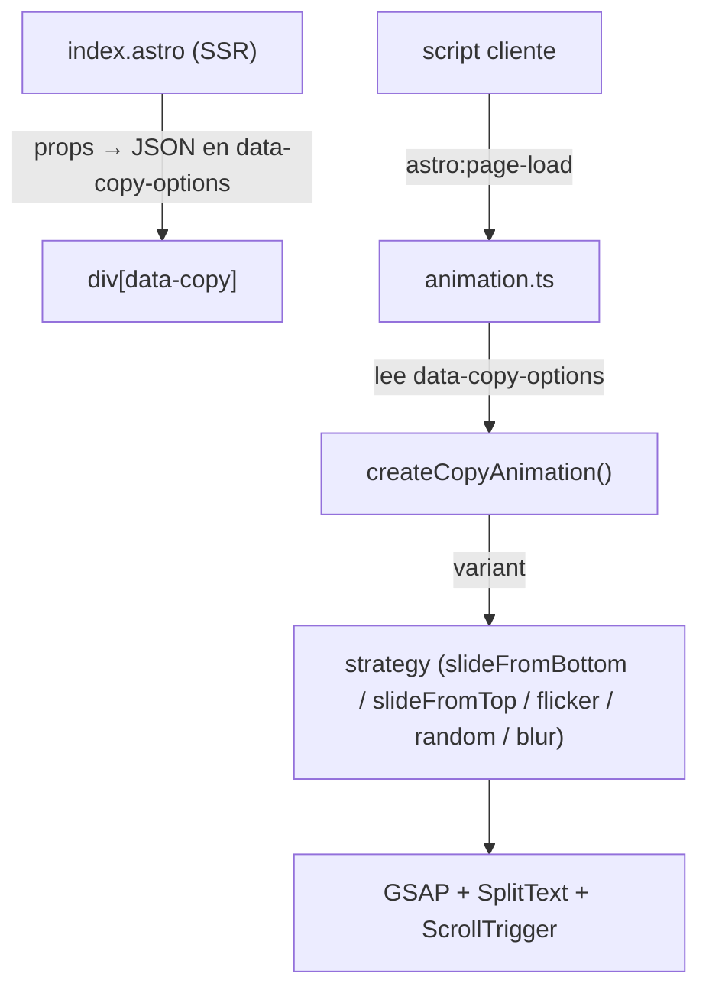

# Componente `Copy` (reveal de texto)

Componente shared para animar la aparición de texto (líneas, palabras o caracteres) con GSAP + SplitText. Reemplaza al antiguo `CopyReact`.

Hub: [methodology.md](./methodology.md) · Componentes: [components.md](./components.md) · Animación: [../section-animation.md](../section-animation.md)

Código: [`src/components/Copy/`](../../src/components/Copy/)

---

## Cuándo usarlo

- Titulares / párrafos que deben revelarse al entrar en viewport, al montar, o ligados al scroll.
- Es shared (se usa en varias secciones). Vive en `src/components/`.

Uso mínimo:

```astro
---
import Copy from '../../components/Copy/index.astro';
---

<Copy>
  <h1>Subject Identified</h1>
</Copy>
```

El slot se envuelve **siempre** en un `<div data-copy>` (Astro no puede clonar el hijo único como React). Los nodos de texto anidados comparten un mismo stagger secuencial.

---

## Arquitectura



- **`index.astro`** — define props, las serializa a `data-copy-options` (JSON) y bootea el script. El frontmatter **no** importa GSAP (corre en servidor).
- **`animation.ts`** — corre en cliente en `astro:page-load`; parsea el JSON, inicializa cada `[data-copy]`, mantiene un `Map` de instancias y limpia las que salen del DOM (`pruneDetached`) — idempotente con View Transitions.
- **`utils/copy/createCopyAnimation.ts`** — espera a las fuentes, mezcla defaults + opciones y delega en la strategy.
- **`utils/copy/strategies/`** — **solo** archivos de variantes (`slide.ts`, `blur.ts`, … + `index.ts` del registry).
- **`utils/copy/`** (fuera de strategies) — helpers compartidos: `types.ts`, `masked-reveal.ts`, `eases.ts`, `shared.ts`, `createCopyAnimation.ts`.

Visibilidad: el root se oculta con `[data-copy]:not(.copy-ready)` hasta que la strategy termina el setup y añade `copy-ready` (evita FOUC antes del split).

---

## Props

| Prop | Tipo | Default | Notas |
| ---- | ---- | ------- | ----- |
| `variant` | `'slideFromBottom' \| 'slideFromTop' \| 'flicker' \| 'random' \| 'blur' \| 'depth' \| string` | `'slideFromBottom'` | Strategy registrada. (`slide` sigue como alias de `slideFromBottom`.) |
| `animateOnScroll` | `boolean` | `true` | `true` = al entrar en viewport; `false` = al montar. Ignorado con `scrub`. |
| `delay` | `number` | `0` | Segundos antes del reveal (solo play-once). |
| `stagger` | `number \| null` | default de la strategy | Delay entre unidades. |
| `type` | `'lines' \| 'words' \| 'chars'` | `'lines'` | `slideFromBottom` / `slideFromTop` / `blur` / `random`: unidad de split. |
| `trigger` | `string \| null` | `null` | Selector del trigger de ScrollTrigger (default = root). |
| `triggerPoint` | `string \| null` | `null` | Alias de `trigger`; gana si ambos están. |
| `start` | `string \| null` | default de la strategy | ScrollTrigger `start`. |
| `end` | `string \| null` | `'top 20%'` | ScrollTrigger `end` (se usa con `scrub`). |
| `scrub` | `boolean \| number` | `false` | Liga el progress al scroll entre `start`→`end`. Número = suavizado (lag). Solo slides/`random`/`blur`/`depth`. |
| `reverse` | `boolean` | `false` | Play-once: revierte al estado inicial al subir el scroll y re-reproduce al bajar. Ignorado con `scrub` o `flicker`. |
| `ease` | `string \| null` | default de la strategy | Ease GSAP en play-once/mount (`power3.out`, `circ.out`, `hop`, …). Con `scrub` siempre es `none`. |
| `duration` | `number \| null` | default de la strategy | Duración del tween en segundos. Con `scrub` siempre es `1`. |
| `class` | `string` | `''` | Clases del wrapper. |

### Eases

Cualquier ease string de GSAP (`power1.out`, `power3.inOut`, `circ.out`, `expo.out`, `back.out(1.7)`, …) más el custom del proyecto:

- **`hop`** — `CustomEase` registrado en [`eases.ts`](../../src/components/Copy/utils/copy/eases.ts).

Defaults por strategy (si no pasas `ease` / `duration`):

| Strategy | `ease` | `duration` |
| -------- | ------ | ---------- |
| `slideFromBottom` / `slideFromTop` | `power3.out` | `0.9` |
| `random` | `power3.out` | `0.75` |
| `blur` | `power2.out` | `1.1` |
| `depth` | `power3.out` | `1.15` |

### Compatibilidad por variante

| Variante | Split | `scrub` | `reverse` | `ease` |
| -------- | ----- | ------- | --------- | ------ |
| `slideFromBottom` | lines / words / chars (mask, desde abajo) | sí | sí | sí |
| `slideFromTop` | lines / words / chars (mask, desde arriba) | sí | sí | sí |
| `random` | lines / words / chars (3D `rotateX`, stagger aleatorio) | sí | sí | sí |
| `blur` | lines / words / chars (`filter: blur` + opacity) | sí | sí | sí |
| `depth` | words (perspective + `rotateX` + Z + blur) | sí | sí | sí |
| `flicker` | chars (scramble por timers) | no | no | no |

---

## Modos de reproducción

- **Play-once** (default): al llegar a `start` se reproduce una vez.
- **Reverse** (`reverse`): como play-once, pero al subir el scroll y salir por `start` se revierte, y vuelve a reproducirse al bajar (`toggleActions: play none none reverse`).
- **Scrub** (`scrub`): el progress sigue el scroll entre `start` y `end` (revierte solo al subir; `reverse` y `ease` no aplican; `duration` se fuerza a `1`).
- **On mount** (`animateOnScroll={false}`): se reproduce al inicializar, sin ScrollTrigger.

---

## Ejemplos

```astro
<!-- Play once -->
<Copy>
  <h1>Subject Identified</h1>
</Copy>

<!-- Ease + duration -->
<Copy ease="hop" duration={1.2}>
  <h1>Subject Identified</h1>
</Copy>

<Copy ease="circ.out" duration={0.6}>
  <p>Soft circular ease</p>
</Copy>

<!-- Reverse al subir el scroll -->
<Copy reverse>
  <h2>We help with your odyssey</h2>
</Copy>

<!-- Scrub ligado al scroll -->
<Copy scrub start="top 85%" end="top 35%">
  <h2>This follows your scroll</h2>
</Copy>

<!-- Slide desde arriba -->
<Copy variant="slideFromTop" type="words">
  <h2>We help with your odyssey</h2>
</Copy>

<!-- Random 3D flip (chars por palabra + stagger aleatorio) -->
<Copy variant="random" type="chars" delay={0.15}>
  <h1>ODYSSEY</h1>
</Copy>

<!-- Blur: foco progresivo (mejor con scrub) -->
<Copy variant="blur" scrub start="top 90%" end="top 30%">
  <p>Long body copy that clears line by line…</p>
</Copy>

<!-- Depth: revelación 3D por palabra -->
<Copy variant="depth" stagger={0.1}>
  <h2>Preventing burnout and</h2>
</Copy>

<!-- Flicker al montar -->
<Copy variant="flicker" animateOnScroll={false}>
  <p>Surveillance log entry</p>
</Copy>
```

---

## Añadir una strategy

1. Crear **solo** el archivo de variante en `utils/copy/strategies/miVariante.ts` (no metas helpers ahí).
   - Para un reveal enmascarado, por filtro o 3D, importar `createMaskedRevealStrategy` desde `../masked-reveal` y `resolveCopyEase` desde `../eases`.
   - Para algo distinto (timers, etc.), implementar el contrato `CopyStrategy` a mano (ver `flicker.ts`).
2. Registrarla en [`utils/copy/strategies/index.ts`](../../src/components/Copy/utils/copy/strategies/index.ts) (o en runtime con `registerCopyStrategy`).
3. Usarla con `<Copy variant="miVariante">`.

Si añades una strategy con nuevas opciones, propágalas por el mismo camino: `index.astro` (prop + JSON) → `animation.ts` (payload + default) → `createCopyAnimation.ts` (merge) → `types.ts` (`CopyOptions`).
